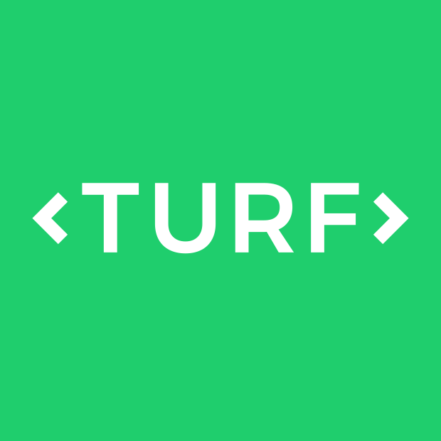
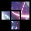
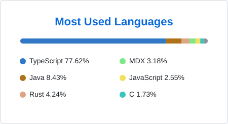

[][website]

## Hey, I'm Egor Prokhorov

I build web and mobile apps with React / React Native / Vue, Effector / Pinia, TypeScript and etc. I also work on interactive maps, data visualization, and 3D motion for the web. I design software architecture, write scripts, build pipelines, manage Git workflows, work with AI coding agents, and handle deployments. I also develop complex business logic, automate processes, and analyze data.

I fine-tune models, prepare datasets, and optimize inference for local and cloud AI. I also develop open-source projects and publish models and datasets on Hugging Face.

 

## Local & Cloud AI tooling

<table width="100%">
<tbody>
<tr>
<td width="210"><strong>CLI&nbsp;agents</strong></td>
<td width="9999">&nbsp;
&nbsp;
&nbsp;
&nbsp;
</td>
</tr>
<tr>
<td width="210"><strong>AI&nbsp;editors</strong></td>
<td width="9999">&nbsp;
</td>
</tr>
<tr>
<td width="210"><strong>AI&nbsp;platforms</strong></td>
<td width="9999">&nbsp;
&nbsp;
&nbsp;
</td>
</tr>
<tr>
<td width="210"><strong>Search&nbsp;&amp;&nbsp;chat</strong></td>
<td width="9999">&nbsp;
</td>
</tr>
<tr>
<td width="210"><strong>Images&nbsp;&amp;&nbsp;workflows</strong></td>
<td width="9999"></td>
</tr>
<tr>
<td width="210"><strong>Music&nbsp;&amp;&nbsp;audio</strong></td>
<td width="9999"></td>
</tr>
<tr>
<td width="210"><strong>Fine&#8209;tuning&nbsp;&amp;&nbsp;training</strong></td>
<td width="9999">&nbsp;
&nbsp;
</td>
</tr>
</tbody>
</table>

 

**Model runtime & optimization:** llama.cpp (CUDA/Volta), GGUF K-quants, LoRA adapters, Flash Attention, KV-cache tuning, multi-GPU tensor placement, speculative decoding (DFlash2, EAGLE-3, MTP), and inference benchmarking (prefill, decode, VRAM).

**Additional tooling:** BitFrost, LiteLLM

---

### AI projects, models & datasets

**[Model Improvement Lab](https://github.com/biscet/Model-Improvement-Lab)** is a local research toolkit for pretrained inference, fine-tuning, and Hugging Face packaging of vision, speech, music, and draft models. It also supports DFlash2 (D-PACE) and EAGLE-3 speculative decoding, GGUF feature capture, and draft benchmarking.\
**[ML Docs](https://github.com/biscet/ML-Docs)**: bilingual notes on LLM training, speculative decoding, and experiments.

 

**Personal profile**

[My Hugging Face profile](https://huggingface.co/biscet)

<!-- HF_ALL_TIME_DOWNLOADS:START -->
- **Models:** [Whittle-35B-A3B-DFlash2](https://huggingface.co/biscet/Whittle-35B-A3B-DFlash2) (224 downloads) · [Whittle-35B-A3B-Vision](https://huggingface.co/biscet/Whittle-35B-A3B-Vision) (299 downloads).
- **Datasets:** [DFlash-DeepSeek-TraceMix](https://huggingface.co/datasets/biscet/DFlash-DeepSeek-TraceMix) (681 downloads) · [DFlash-Codex-TraceMix-Lite](https://huggingface.co/datasets/biscet/DFlash-Codex-TraceMix-Lite) (190 downloads) · [SonicRank-Codex-10K](https://huggingface.co/datasets/biscet/SonicRank-Codex-10K) (74 downloads) · [CodeThinker-DeepSeek-Agentic](https://huggingface.co/datasets/biscet/CodeThinker-DeepSeek-Agentic) (57 downloads).
<!-- HF_ALL_TIME_DOWNLOADS:END -->

---

**Oboro AI** — Local models, fine-tuning, and inference experiments. **Oboro Flash** is in development.

**[OboroLabs](https://github.com/OboroAI/OboroLabs)** runs reproducible benchmarks for model latency and output quality.

[Hugging Face](https://huggingface.co/oboro-ai) · [GitHub organization](https://github.com/OboroAI)

<!-- OBORO_ALL_TIME_DOWNLOADS:START -->
- **Model:** [Oboro-Blink-1.0](https://huggingface.co/oboro-ai/Oboro-Blink-1.0) (265 downloads).
<!-- OBORO_ALL_TIME_DOWNLOADS:END -->

<!-- HF_TOTAL_DOWNLOADS:START -->
**Total model & dataset downloads: 1,790 all-time** across [biscet](https://huggingface.co/biscet) and [Oboro AI](https://huggingface.co/oboro-ai).
<!-- HF_TOTAL_DOWNLOADS:END -->

---

## Technologies I use

**Current focus**

- **Web & mobile.** I build TypeScript apps with React and Vue on the web and React Native with Expo on mobile. I use Effector and Pinia for state management, Vite for web builds, and tRPC for typed APIs.
- **Maps & visualization.** I build interactive maps, geometry editors, and analytical dashboards with MapLibre GL JS, Turf.js, Terra Draw, PMTiles vector tiles, and Chart.js.
- **3D & motion.** I create WebGL scenes with Three.js, React Three Fiber, Drei, and custom GLSL shaders. I use GSAP and Lenis for scroll-driven camera motion and Motion for Vue for interface animations.

 

<table width="100%">
<thead>
<tr><th colspan="2" width="5000">Tech stack</th><th colspan="2" width="5000">Other tech stack</th></tr>
</thead>
<tbody>
<tr>
<td><strong>Languages</strong></td>
<td width="9999">&nbsp;
&nbsp;
&nbsp;
</td>
<td><strong>AI &amp; ML</strong></td>
<td width="9999">&nbsp;
</td>
</tr>
<tr>
<td><strong>Web &amp; mobile</strong></td>
<td width="9999">&nbsp;
&nbsp;
&nbsp;
</td>
<td><strong>Frameworks &amp; routing</strong></td>
<td width="9999">&nbsp;
</td>
</tr>
<tr>
<td><strong>State management</strong></td>
<td width="9999">&nbsp;
&nbsp;
</td>
<td><strong>Data &amp; utilities</strong></td>
<td width="9999">&nbsp;
&nbsp;
&nbsp;
&nbsp;
&nbsp;
</td>
</tr>
<tr>
<td><strong>UI &amp; styling</strong></td>
<td width="9999">&nbsp;
&nbsp;
</td>
<td><strong>Maps &amp; geospatial</strong></td>
<td width="9999">&nbsp;
&nbsp;
&nbsp;
</td>
</tr>
<tr>
<td><strong>3D &amp; WebGL</strong></td>
<td width="9999">&nbsp;
&nbsp;
&nbsp;
&nbsp;
&nbsp;
</td>
<td><strong>Data visualization</strong></td>
<td width="9999">&nbsp;
</td>
</tr>
<tr>
<td><strong>Tooling</strong></td>
<td width="9999">&nbsp;
&nbsp;
</td>
<td><strong>UI &amp; motion</strong></td>
<td width="9999">&nbsp;
&nbsp;
&nbsp;
&nbsp;
&nbsp;
</td>
</tr>
<tr>
<td><strong>Server</strong></td>
<td width="9999">&nbsp;
&nbsp;
&nbsp;
&nbsp;
</td>
<td><strong>Build &amp; quality</strong></td>
<td width="9999">&nbsp;
&nbsp;
</td>
</tr>
<tr>
<td><strong>Testing</strong></td>
<td width="9999">&nbsp;
&nbsp;
&nbsp;
&nbsp;
&nbsp;
</td>
<td><strong>Docs &amp; specs</strong></td>
<td width="9999">&nbsp;
</td>
</tr>
</tbody>
</table>

---

## Links

<!-- PRIVATE_LANGUAGE_STATS:START -->
<picture>
  <source media="(prefers-color-scheme: dark)" srcset="https://raw.githubusercontent.com/biscet/biscet/master/assets/languages-dark.svg?v=2a7424d6090d" />
  <source media="(prefers-color-scheme: light)" srcset="https://raw.githubusercontent.com/biscet/biscet/master/assets/languages-light.svg?v=2a7424d6090d" />
  
</picture>
<!-- PRIVATE_LANGUAGE_STATS:END -->

<strong>Connect with me</strong>

&nbsp;
&nbsp;
&nbsp;
&nbsp;

<strong>My media</strong>

&nbsp;
&nbsp;
&nbsp;

 

---

[website]: https://biscet-prtfl.vercel.app/
[vk]: https://vk.com/id607761386
[pinterest]: https://www.pinterest.ru/biscet275
[instagram]: https://instagram.com/_blsrng
[upwork]: https://www.upwork.com/freelancers/~01b350467f78c03786
[gmail]: mailto:befealmellow@gmail.com
[telegram]: https://t.me/biscet16581
[soundcloud]: https://soundcloud.com/biscet
[habr]: https://career.habr.com/biscet
[hhru]: https://togliatti.hh.ru/resume/b27a8469ff09bddac80039ed1f5358466e6534
[yandex]:https://music.yandex.ru/users/biscet/playlists/3

